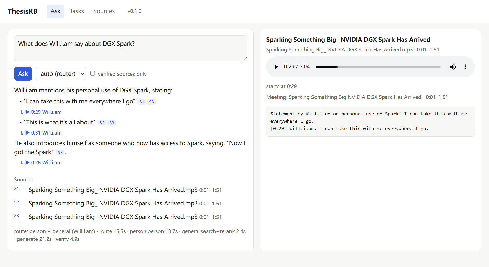

# ThesisKB

A private, multimodal knowledge base for a thesis (or any research project): papers, photos of
whiteboards and handwritten notes, meeting recordings and interview videos — searchable, with
answers that cite the exact **page, image or timestamp and speaker**, and a second check that
flags every sentence its source doesn't support. Runs fully local on one 16 GB GPU; a cloud LLM
is optional.



**What it answers well**

| Question | How |
|---|---|
| "What is the state of the art for designing diffusion models?" | literature path: several searches over your papers, per-passage evidence summaries, synthesis with page citations |
| "What does Prof. X prefer for the evaluation?" | person path: only what that person said (speaker-labelled transcripts) or wrote |
| "Who does what until when?" / "When is my mid-term?" | tasks extracted from notes and meetings into a table, answered by SQL, sorted by date |
| "Which datasets / products appear in my sources?" | entities and relations extracted at ingestion, queried with SQL |
| anything else | hybrid search (vectors + keywords) over all sources, reranked |

Answers only cover what you put in — they are a reading guide for your own library, not a
source to cite in the thesis.

## Quickstart

Tested end to end on Windows 10 with an RTX 4070 Ti SUPER (16 GB). The code is
platform-independent and CI runs the test suite plus a CPU integration test on Linux; the full
GPU setup on Linux/WSL2 follows the same steps but has not been run yet (BUILD_GUIDE Milestone 9).

**Prerequisites:** [Docker](https://docs.docker.com/get-docker/), [Ollama](https://ollama.com),
[uv](https://docs.astral.sh/uv/), ffmpeg, [Tesseract](https://tesseract-ocr.github.io/) with the
`deu` + `eng` language packs, an NVIDIA GPU with current drivers (or see *Small / CPU setup*).

```bash
git clone https://github.com/HenryCai-st/thesiskb && cd thesiskb
uv sync --extra local        # Python env incl. Docling, CUDA PyTorch, Whisper, pyannote (~5 GB)
cp .env.example .env         # then edit: TKB_HF_TOKEN (speaker separation), Tesseract path on Windows
docker compose up -d         # PostgreSQL + pgvector
uv run tkb db upgrade        # create the schema
ollama pull qwen3:14b && ollama pull bge-m3 && ollama pull qwen2.5vl:7b
uv run tkb doctor            # checks DB, GPU, models, keys, ffmpeg, tesseract
```

Speaker separation uses a gated model: create a free Hugging Face account, accept the terms of
[pyannote/speaker-diarization-community-1](https://huggingface.co/pyannote/speaker-diarization-community-1),
and put a *read* token in `.env` as `TKB_HF_TOKEN`. Without it, set the diarization backend to
`none` (one speaker per recording).

<details><summary>Platform notes</summary>

- **Windows:** Tesseract's installer does not add it to PATH; set `TKB_TESSERACT_CMD` (and
  `TKB_TESSDATA_DIR` if the language packs are in a user folder) in `.env`.
- **WSL2:** keep the repo and `data/` inside the WSL filesystem (`~/thesiskb`), not on `/mnt/c`;
  install Ollama inside WSL; give WSL enough RAM in `%UserProfile%\.wslconfig` (`memory=22GB`).
- **Ollama:** `OLLAMA_MAX_LOADED_MODELS=1` keeps one large model in VRAM at a time.
</details>

## Using it

```bash
cp ~/Downloads/*.pdf data/raw/       # papers, photos, recordings, videos — anything below
uv run tkb ingest data/raw           # re-run any time: finished work is skipped
uv run tkb serve                     # web UI on http://127.0.0.1:8000
uv run tkb ask "How is diffusion model developing?"
```

| Input | Becomes |
|---|---|
| PDF, DOCX, PPTX, Markdown, HTML | pages with sections, tables and figure captions; arXiv metadata |
| Photos (JPG, PNG, HEIC) | turned upright, read by a vision model (handwriting) + OCR; post-its split |
| Audio (MP3, WAV, M4A) | transcript with per-sentence timestamps, split by speaker |
| Video (MP4, MKV, MOV) | as audio, plus keyframes described by the vision model |

Then label speakers (`tkb speakers list/label`), review extracted tasks (`tkb tasks review`),
and mark sources you checked (`tkb verify`). **The day-to-day workflow is in
[docs/usage.md](docs/usage.md).**

Other ways in: an OpenAI-compatible endpoint (`http://localhost:8000/v1`, model `thesiskb`) for
Open WebUI or any OpenAI client, and an MCP server for Claude and other agents:

```bash
claude mcp add thesiskb -- uv --directory /path/to/thesiskb run tkb mcp
```

## Hardware and models

| Role | Default (local, Ollama / in-process) | VRAM |
|---|---|---|
| Answer, routing, extraction, support check | qwen3:14b (Q4) | ~12 GB incl. context |
| Vision (photos, keyframes) | qwen2.5vl:7b | ~7 GB |
| Embeddings | bge-m3 | ~1.5 GB |
| Reranker | bge-reranker-v2-m3 (fp16) | ~1.2 GB |
| Speech-to-text | faster-whisper large-v3-turbo | ~4 GB |
| Speaker separation | pyannote community-1 | ~1.5 GB |

Only one large model is loaded at a time; ingestion runs in batches per model. Disk: ~20 GB of
models plus the Python environment; data as large as your recordings. Measured on a 4070 Ti
SUPER: a 60-page paper indexes in ~1.5 min (+ ~40 min optional entity extraction), 3 min of
audio in ~20 s, a photo in ~15 s; answers take 20–70 s.

**Three setups** (`TKB_MODELS_FILE` in `.env`):
- `models.yaml` — fully local (default).
- [`examples/models.api.yaml`](config/examples/models.api.yaml) — API mode: a cloud LLM
  (Claude here; any LiteLLM provider) answers and extracts; embeddings, vision, speech stay local.
  Sources marked `tkb local-only` never reach the cloud model.
- [`examples/models.cpu.yaml`](config/examples/models.cpu.yaml) — small models for a laptop.

## How it works

Every file is identified by its SHA-256; each stage writes its output to
`data/processed/<sha256>/` and is skipped when done. Chunks carry locators (page + bounding box,
time range + speaker, image region, line), extracted facts carry verbatim evidence quotes, and
answers cite numbered passages that are mapped back to chunks and checked sentence by sentence.
Details: [docs/architecture.md](docs/architecture.md); every non-obvious decision with the
measurements behind it: [docs/adr](docs/adr).

**Extending:** add a file type (`Parser`), a model backend (`register_backend`), an extraction
schema (`Extractor`) or an answer path without touching the core — see
[docs/architecture.md#extending](docs/architecture.md#extending) and the working
[examples/plugins](examples/plugins) (plain-text notes, meeting decisions).

## Evaluation

`tkb eval` runs [eval/questions.yaml](eval/questions.yaml) and stores each run with the git SHA
and a config hash. On the author's fixture set (one survey paper, one handwritten schedule, one
audio clip, one video; 11 questions): cited the expected source 11/11, router 11/11, quote
timestamps within ±5 s 2/2 (checked against YouTube subtitles), task recall 6/6, invalid
citations 0, sentences supported 89–100 % depending on the run.

## Development

```bash
uv run pytest                   # unit tests, models mocked (a *_test database for DB tests)
uv run pytest -m integration    # real Docling + Whisper on a synthetic PDF and speech clip
uv run ruff check . && uv run ruff format .
```

Rules for coding agents (and humans): [AGENTS.md](AGENTS.md). The original build plan:
[BUILD_GUIDE.md](BUILD_GUIDE.md).

## Privacy

Everything stays on your machine unless you enable API mode. Recordings of people need their
consent (`tkb consent`); `tkb forget-person` removes a person's data. Never commit `data/`,
`.env` or recordings — they are git-ignored. Details in [docs/usage.md](docs/usage.md#6-privacy).

## License

MIT
